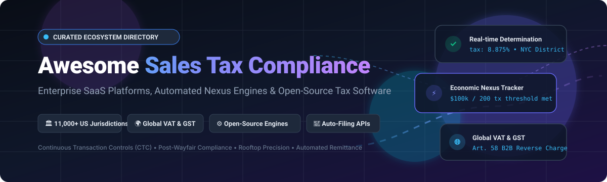

<div align="center">



# 🧾 Awesome Sales Tax Compliance 🏛️

**A curated index of top-tier SaaS platforms, real-time tax calculation engines, automated nexus monitors, and open-source indirect tax frameworks.**

[](https://github.com/ishandutta2007/Awesome-Awesome-Awesome)[](https://discord.gg/jc4xtF58Ve)
[](http://makeapullrequest.com)
[](https://opensource.org/licenses/MIT)
[](https://github.com/ishandutta2007)

*Empowering e-commerce merchants, marketplace operators, SaaS CFOs, and fintech engineers to automate sales and use tax, global VAT/GST, Continuous Transaction Controls (CTC), and Post-Wayfair economic nexus determination.* 🚀

---

</div>

## 📑 Table of Contents
- [🔍 Sector Overview & Market Dynamics](#-sector-overview--market-dynamics)
- [🏢 SaaS & Managed Enterprise Platforms](#-saas--managed-enterprise-platforms)
- [⚙️ Open-Source GitHub Projects](#️-open-source-github-projects)
- [🧩 Architectural Comparison & Implementation Nuances](#-architectural-comparison--implementation-nuances)
- [🤝 How to Contribute](#-how-to-contribute)
- [⚖️ Disclaimer](#️-disclaimer)

---

## 🔍 Sector Overview & Market Dynamics

The global sales and indirect tax compliance software market is estimated at **$8.4B to $11.2B in 2026** (forming part of the broader **$26B+** global tax management software ecosystem) and is expanding at an 11% CAGR driven by strict post-*South Dakota v. Wayfair* economic nexus mandates, real-time Continuous Transaction Controls (CTC), and cross-border digital VAT/GST regulations. 

The sector operates under a **bimodal market structure**: it is **highly concentrated at the enterprise top** (an oligopolistic core led by established incumbents like Thomson Reuters, Avalara, Vertex, and Sovos that command high moats around proprietary tax rate databases and deep ERP integrations), yet **increasingly fragmented across the SMB and modern cloud segments**, where specialized startups (such as Stripe Tax, Anrok, and Zamp) compete aggressively with modern developer-first APIs, AI-driven exemption handling, and automated multi-state remittance.

---

## 🏢 SaaS & Managed Enterprise Platforms

The table below lists leading commercial indirect tax and sales tax compliance solutions, sorted by **company scale (valuation / market capitalization) in descending order**:

| 🏢 Platform | 💰 Valuation / Company Scale | 🏷️ Specific Starting Price | 🎁 Specific Free Tier / Trial Limit | 🌐 Primary Coverage & Key Capabilities |
| :--- | :--- | :--- | :--- | :--- |
| **[Shopify Tax](https://help.shopify.com/en/manual/taxes/shopify-tax/choose-tax-service)** | **~$213.3B Market Cap** *(NYSE: SHOP)* | **0.35% per order** (US) / **0.25% per order** (EU, UK, CA; capped at $0.99/order) | **Free for life until $100,000 GMV** per store (resets annually for pre-May 2026 stores, lifetime cap for newer stores) | Native Shopify integration; rooftop calculation across US, EU, UK, and Canada with dynamic tax-inclusive pricing. |
| **[Stripe Tax](https://stripe.com/tax)** | **~$159.0B Valuation** *(Private tender offer)* | **0.50% per transaction** (no-code checkout) or **$0.50 per transaction** (via Tax API) | **No free tier**; 10 free API calculation calls included per taxable transaction; pay-as-you-go thereafter | Integrated directly into Stripe Billing & Invoicing; automated calculations across 50+ countries and all US states. |
| **[Thomson Reuters ONESOURCE](https://tax.thomsonreuters.com/)** | **~$53.8B Market Cap** *(NYSE: TRI; $7.8B Rev)* | **$1,500/month** *(Base enterprise indirect tax determination contracts start at ~$18,000/year)* | **No free tier or trial for core determination** *(Select Global Trade components offer 30-day trial)* | Enterprise ERP indirect tax determination suite; comprehensive multi-national VAT, GST, and US multi-state compliance. |
| **[Avalara AvaTax](https://marketplace.microsoft.com/en-us/product/avalara.avatax-agentic-tax-and-compliance)** | **~$8.4B Valuation** *(Vista Equity buyout; ~$1B+ Rev)* | **$69/month** *(Avalara AvaTax for Small Business tier, billed annually at $828/year for 1 state)* | **90-Day Free Trial** (API sandbox environment capped at 1,000 test transactions; no credit card required) | Global tax calculation across US and 190+ countries; certified Streamlined Sales Tax (SST) CSP with automated remittance. |
| **[TaxJar](https://www.taxjar.com/)** | **~$8.4B Ecosystem** *(Acquired by Stripe; $200M deal)* | **$39/month** *(Starter Plan: up to 200 orders/month, 3 integrations, 2 annual AutoFile credits)* | **30-Day Free Trial** (Full access, imports up to 60 days of historical sales data; no credit card required) | Rooftop-accurate sales tax calculation APIs, multi-state economic nexus tracking, and automated state AutoFile returns. |
| **[Vertex Cloud](https://www.vertexinc.com/)** | **~$3.2B Market Cap** *(NASDAQ: VERX; $748M Rev)* | **$500/month** *(Standard Vertex Cloud entry contracts start at ~$6,000/year for base volume)* | **No free tier or trial** (Requires commercial demonstration and custom enterprise scoping) | Enterprise sales tax, consumer use tax, and global VAT calculation; certified connectors for SAP, Oracle, and NetSuite. |
| **[Sovos](https://sovos.com/)** | **~$3.0B Valuation** *(PE-backed by Hg & TA; ~$500M Rev)* | **$458/month** *(Base Sales & Use Tax Cloud packages start at ~$5,500/year for standard filing)* | **No free tier or trial** (Requires sales evaluation and compliance architecture demo) | Global compliance cloud covering sales tax, VAT, e-invoicing mandates, and continuous transaction controls across 70+ nations. |
| **[Anrok](https://www.anrok.com/)** | **~$525M Valuation** *(Series C funded)* | **$100/month per active jurisdiction** *(Starter Tier covering real-time tax APIs & physical nexus tracking)* | **No permanent free tier**; Free interactive nexus exposure evaluation & pilot sandbox via sales demo | SaaS-specialized sales tax platform; monitors SaaS-specific taxability laws and tracks economic nexus across 11,000+ US jurisdictions. |
| **[Zamp](https://www.zamp.com/)** | **~$150M Valuation** *(Series B funded)* | **$250/month** *(Standard compliance plan scaling with active state registrations)* | **Permanent Free Tier** (Free one-time nexus assessment, historical liability report & 30-min CPA consult) + **30-Day API Sandbox** | AI-driven tax operations providing end-to-end nexus registration, tax calculation APIs, and guaranteed rooftop remittance. |
| **[Quaderno](https://quaderno.io/)** | **~$15M Valuation** *(Bootstrapped profitable)* | **$29/month** *(Hobby Tier: up to 25 transactions, 250 API calls, 1 user, 1 jurisdiction)* | **7-Day Free Trial** (Full feature access without credit card required upfront) | Automated tax compliance engine built for digital products, Stripe, and WooCommerce; instant EU VAT validation and invoices. |

---

## ⚙️ Open-Source GitHub Projects

Open-source sales tax engines offer privacy, offline evaluation, zero per-transaction fees, and deterministic calculation logic. The repositories below are sorted by **GitHub Stars in descending order**:

| 📦 Repository & Project | ⭐ GitHub Stars | 💻 Primary Language | 🎯 Key Architecture & Focus |
| :--- | :--- | :--- | :--- |
| **[node-sales-tax](https://github.com/valeriansaliou/node-sales-tax)** | [](https://github.com/valeriansaliou/node-sales-tax/stargazers) | TypeScript / Node.js | International sales tax calculator that runs completely offline with bundled rates; includes live VIES online VAT fraud validation. |
| **[Automattic woocommerce-services](https://github.com/Automattic/woocommerce-services)** | [](https://github.com/Automattic/woocommerce-services/stargazers) | PHP / JavaScript | Automated sales tax determination and shipping rate computation plugin maintained by the WooCommerce / Automattic core team. |
| **[kdeldycke/vat-rates](https://github.com/kdeldycke/vat-rates)** | [](https://github.com/kdeldycke/vat-rates/stargazers) | Python / Data | Curated and structured database of worldwide VAT and GST rates for digital, telecommunications, and SaaS service sales. |
| **[ibericode/vat-rates](https://github.com/ibericode/vat-rates)** | [](https://github.com/ibericode/vat-rates/stargazers) | JSON / PHP | Actively maintained repository and JSON dataset of official Value Added Tax (VAT) rates across all European Union member states. |
| **[spatie/tax-calculator](https://github.com/spatie/tax-calculator)** | [](https://github.com/spatie/tax-calculator/stargazers) | PHP | Clean, framework-agnostic architectural contracts and calculation primitives for applying compound and inclusive taxes. |
| **[txcrb/tax_cloud](https://github.com/txcrb/tax_cloud)** | [](https://github.com/txcrb/tax_cloud/stargazers) | Ruby | Mature Ruby gem interfacing with the TaxCloud API for certified US sales tax calculations and SST rate determination. |
| **[taxjar/taxjar-php](https://github.com/taxjar/taxjar-php)** | [](https://github.com/taxjar/taxjar-php/stargazers) | PHP | Official open-source client SDK for integrating TaxJar's real-time sales tax calculation and multi-jurisdiction reporting endpoints. |
| **[apilayer/euvatrates.com](https://github.com/apilayer/euvatrates.com)** | [](https://github.com/apilayer/euvatrates.com/stargazers) | Ruby / Static | Fast, lightweight static JSON API tracking VAT compliance rules and rates across all EU member states. |
| **[avadev/AvaTax-REST-V2-PHP-SDK](https://github.com/avadev/AvaTax-REST-V2-PHP-SDK)** | [](https://github.com/avadev/AvaTax-REST-V2-PHP-SDK/stargazers) | PHP | Developer-centric open-source PHP SDK for Avalara's AvaTax REST v2 API, enabling address validation and tax determination. |
| **[omaralalwi/laravel-taxify](https://github.com/omaralalwi/laravel-taxify)** | [](https://github.com/omaralalwi/laravel-taxify/stargazers) | PHP / Laravel | Lightweight Laravel package providing streamlined tax and VAT calculations, percentage deductions, and e-commerce helpers. |
| **[AcebotHEF/Tax-Compliance-Agent](https://github.com/AcebotHEF/Tax-Compliance-Agent)** | [](https://github.com/AcebotHEF/Tax-Compliance-Agent/stargazers) | Python | Autonomous AI agent verifying transactional records against sales tax, VAT, and corporate thresholds to flag non-compliance. |
| **[jpmurray/canada-sale-tax-api](https://github.com/jpmurray/canada-sale-tax-api)** | [](https://github.com/jpmurray/canada-sale-tax-api/stargazers) | PHP / Lumen | Specialized RESTful API microservice serving Canadian Federal (GST) and Provincial (PST/HST/QST) sales tax schedules. |
| **[Kikobeats/country-vat](https://github.com/Kikobeats/country-vat)** | [](https://github.com/Kikobeats/country-vat/stargazers) | JavaScript | Instant lookup table for global VAT, GST, and consumption tax rates by ISO 3166-1 alpha-2 and alpha-3 country codes. |
| **[ejosterberg/open-sales-tax](https://github.com/ejosterberg/open-sales-tax)** | [](https://github.com/ejosterberg/open-sales-tax/stargazers) | PHP / TypeScript | Self-hosted destination-based US sales tax engine featuring pre-built connectors for Saleor and Drupal Commerce. |
| **[vatnode/eu-vat-rates-data](https://github.com/vatnode/eu-vat-rates-data)** | [](https://github.com/vatnode/eu-vat-rates-data/stargazers) | Python / JSON | Daily-audited, typed datasets of standard and reduced VAT rates across 45 European jurisdictions with multi-language wrappers. |
| **[cboxdk/laravel-tax](https://github.com/cboxdk/laravel-tax)** | [](https://github.com/cboxdk/laravel-tax/stargazers) | PHP / Laravel | Enterprise consumption-tax engine for Laravel; handles 51 US states, EU B2B reverse charges, and 20+ national regimes. |
| **[azaharizaman/nexus-tax](https://github.com/azaharizaman/nexus-tax)** | [](https://github.com/azaharizaman/nexus-tax/stargazers) | PHP | Framework-agnostic temporal tax engine with hierarchical compound taxes, append-only immutable audit logs, and nexus gating. |

---

## 🧩 Architectural Comparison & Implementation Nuances

When designing transactional systems for e-commerce, digital products, or SaaS, architectural considerations determine whether to adopt an open-source engine or an enterprise SaaS platform:

```
┌────────────────────────────────────────────────────────────────────────┐
│               TAX DETERMINATION ARCHITECTURAL SPECTRUM                 │
└────────────────────────────────────────────────────────────────────────┘

  [ Self-Hosted / Open-Source ]                [ Commercial SaaS / Managed ]
  • node-sales-tax, cboxdk/laravel-tax         • Avalara, TaxJar, Stripe Tax
  ─────────────────────────────────            ─────────────────────────────
  ✔ Zero per-transaction API fees              ✔ 100% automated rate updates
  ✔ Sub-millisecond local lookups              ✔ Address rooftop geocoding
  ✔ Complete transaction privacy               ✔ Automated filing & remittance
  ✘ Rate tables must be kept updated           ✘ Vendor lock-in & ongoing costs
  ✘ No automated government remittance         ✘ External network latency
```

1. **Rooftop Geocoding vs. ZIP Code Matching**: US ZIP codes do not follow municipal or tax district boundaries. A single 5-digit ZIP code can span multiple counties with different local levies. Commercial engines (Avalara, Vertex, TaxJar) resolve exact 9-digit ZIPs and latitude/longitude coordinates to avoid under/over-collection audits.
2. **Economic Nexus Monitoring**: Under *Wayfair*, merchants triggering $100,000 in gross revenue or 200 separate transactions within a rolling 12-month period in a state acquire physical collection obligations. Platforms like Anrok, Zamp, and Stripe Tax track these thresholds in real time.
3. **Cross-Border VAT & B2B Reverse Charges**: For EU and UK transactions, engines must validate VAT ID numbers via the European Commission VIES system and conditionally zero-rate B2B invoices while applying appropriate reverse-charge annotations.

---

## 🤝 How to Contribute

We welcome additions, corrections, and updates from the open-source and tax engineering communities!

1. 🍴 Fork this repository.
2. ✍️ Add your SaaS tool or open-source repository to `README.md` following the table schema.
3. ⭐ Ensure open-source projects include their official GitHub repository URL and accurate descriptions.
4. 📬 Submit a Pull Request with a clear, concise summary of the addition.

---

## ⚖️ Disclaimer

*This curated directory is provided for informational and educational purposes only. Tax laws, economic nexus thresholds, and international VAT rates change frequently across jurisdictions. Calculating or remitting sales tax incorrectly can create substantial financial liabilities. Always consult certified public accountants (CPAs) or qualified tax attorneys when configuring production tax compliance systems.*

---

<div align="center">

**Built with ❤️ for finance engineers, fintech architects, and global e-commerce builders.**

</div>
